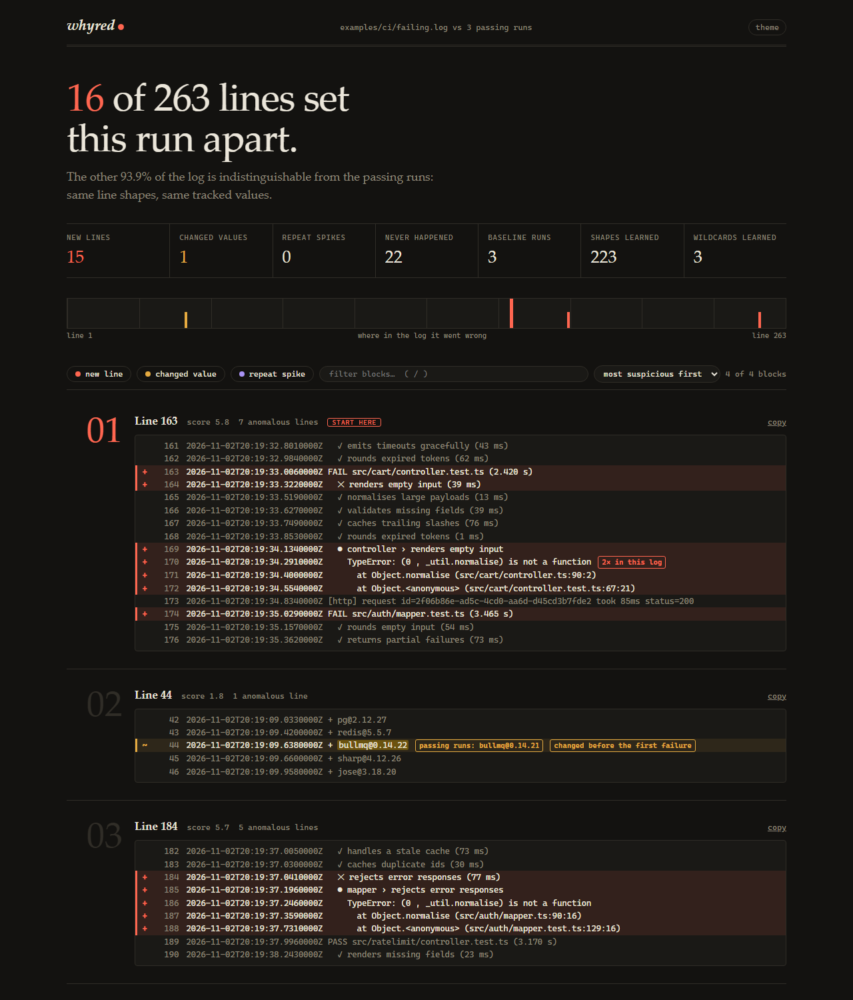
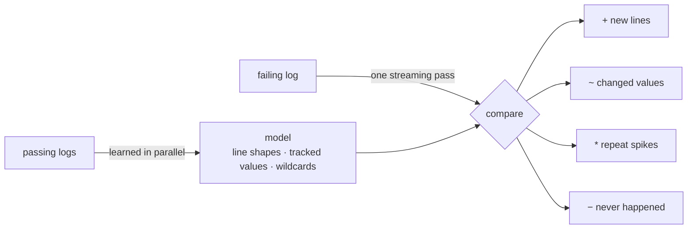

<div align="center">


# whyred

**Why is this run red?**

Give it the logs of a few passing CI runs and the log of a failing one.<br>
It shows the handful of lines that make the failing run different — and the values that silently changed.

[](https://github.com/LovekeshAnand/whyred/actions/workflows/ci.yml)
[](https://pkg.go.dev/github.com/LovekeshAnand/whyred)


[](LICENSE)

[Quick start](#quick-start) · [How it works](#how-it-works) · [Benchmarks](#benchmarks) · [Architecture](docs/ARCHITECTURE.md) · [Limits](#limits)

</div>

---

```console
$ whyred passing-1.log passing-2.log passing-3.log failing.log -C 1 --top 3
whyred: 16 lines of 263 do not fit the baseline (6 blocks).
  baseline: 3 runs, 866 lines -> 223 line shapes, 3 wildcards learned

#2  line 44  score 1.8
        43 | 2026-11-02T20:19:09.4200000Z + redis@5.5.7
 ~      44 | 2026-11-02T20:19:09.6380000Z + bullmq@0.14.22   <- bullmq@0.14.22 was bullmq@0.14.21; changed before the first failure
        45 | 2026-11-02T20:19:09.6600000Z + sharp@4.12.26

#1  line 169  score 5.7   <- start here
       168 | 2026-11-02T20:19:33.8530000Z   ✓ rounds expired tokens (1 ms)
 +     169 | 2026-11-02T20:19:34.1340000Z   ● controller › renders empty input
 +     170 | 2026-11-02T20:19:34.2910000Z     TypeError: (0 , _util.normalise) is not a function   <- 2x in this log
 +     171 | 2026-11-02T20:19:34.4000000Z       at Object.normalise (src/cart/controller.ts:90:2)
 +     172 | 2026-11-02T20:19:34.5540000Z       at Object.<anonymous> (src/cart/controller.test.ts:67:21)
 ...
never happened: 22 line shapes present in every baseline run
 -         | 2026-11-03T17:03:38.7250000Z PASS src/auth/mapper.test.ts (3.159 s)
 -         | 2026-11-03T17:03:51.5710000Z Test Suites: 16 passed, 16 total
 -         | 2026-11-03T17:03:52.4540000Z ##[group]Run docker build -t storefront .
```

This is real output for the logs in [`examples/ci`](examples/ci). The cause of
that failure is **line 44**: a dependency floated to a new patch release.
Nothing on that line says "error", so `grep` never shows it, and `diff` buries
it under 260 timestamp changes.

## Contents

- [Why](#why)
- [Features](#features)
- [Quick start](#quick-start)
- [Usage](#usage)
- [The HTML report](#the-html-report)
- [How it works](#how-it-works)
- [Benchmarks](#benchmarks)
- [Security](#security)
- [Limits](#limits)
- [Development](#development)
- [License](#license)

## Why

When CI fails, the log is thousands of lines long and the standard tools are
`grep -i error` and scrolling.

- **`grep`** misses every failure that doesn't use the word, and shows every
  test that logs an *expected* error.
- **`diff`** against a passing run reports every line, because every line has
  a timestamp.
- **Regex-then-diff scripts** break when a parallel test runner prints files in
  a different order, and only know the noise someone wrote a pattern for.

whyred starts from one observation: **two passing runs disagree with each
other exactly where the noise is.** So it needs no list of noise patterns. It
learns them from your own green runs.

| | finds failures that don't say "error" | ignores timestamps, ids, durations | ignores reordered output | learns project-specific noise | catches values that changed |
|---|:-:|:-:|:-:|:-:|:-:|
| `grep -i error` | ✗ | — | — | ✗ | ✗ |
| `diff` | ✓ | ✗ | ✗ | ✗ | drowned |
| regex-normalise + `diff` | ✓ | only the ones you listed | ✗ | ✗ | drowned |
| logreduce / LogJuicer¹ | ✓ | ✓ | ✓ | from baselines | ✗ |
| **whyred** | ✓ | ✓ | ✓ | from passing runs disagreeing | ✓ |

<sub>¹ From their documentation; not benchmarked here. See [docs/BENCHMARKS.md](docs/BENCHMARKS.md).</sub>

## Features

- **Learned noise.** Runner names, PIDs, ports, temp directories, hashed asset
  names and commit messages are recognised as noise once two passing runs
  disagree on them.
- **Changed values.** A value every passing run agreed on that is different in
  the failing run is reported: `0 failed` → `2 failed`, `exit code 0` → `1`, a
  dependency version, a status code.
- **What never happened.** Lines every passing run printed and this one didn't,
  in order — the first few show where the run stopped.
- **Order-independent.** Logs are compared as a multiset of line shapes, so
  parallel output in a different order is not a difference.
- **Ranked.** The first failure-looking block comes first, then values that
  changed before it.
- **Four outputs.** Coloured text, Markdown for `$GITHUB_STEP_SUMMARY`, JSON,
  and a self-contained HTML report.
- **Reusable baselines.** `whyred learn` saves a small model so you don't have
  to keep the passing logs.
- **One binary, no dependencies.** Go standard library only. Reads gzip and
  UTF-16 input, streams logs of any size in bounded memory.

## Quick start

Requires Go 1.24 or newer.

```sh
go install github.com/LovekeshAnand/whyred@latest
```

Or build from a clone:

```sh
git clone https://github.com/LovekeshAnand/whyred
cd whyred
go build -o whyred .          # whyred.exe on Windows
```

Try it on the bundled example:

```sh
whyred examples/ci/passing-*.log examples/ci/failing.log
```

## Usage

```sh
whyred passing.log failing.log                  # one baseline works
whyred pass-*.log failing.log                   # two or three is much better
some-command 2>&1 | whyred passing.log -        # failing log from stdin
whyred pass-*.log failing.log -o report.html    # self-contained HTML report
whyred pass-*.log failing.log -f md >> "$GITHUB_STEP_SUMMARY"
whyred pass-*.log failing.log -f json           # for other tools
```

Save a baseline once and reuse it:

```sh
whyred learn -o ci.whyred pass-1.log pass-2.log pass-3.log
whyred --model ci.whyred failing.log
```

### Reading the output

| marker | meaning |
|:-:|---|
| `+` | a line shape no passing run ever printed |
| `~` | a known line, but a value every passing run agreed on is different |
| `*` | a known line repeated far more often than in any passing run (retry loops) |
| `-` | *never happened*: printed by every passing run, missing from this one |

### Options

| flag | default | |
|---|---|---|
| `-f`, `--format` | `text` | `text`, `md`, `json` or `html`; inferred from the `-o` extension |
| `-o`, `--output` | stdout | write the report (or, with `learn`, the model) to a file |
| `-C`, `--context` | `2` | context lines around each anomaly |
| `-n`, `--top` | `25` | show only the N highest-ranked blocks; `0` shows all |
| `-m`, `--model` | | use a model saved by `whyred learn` as the baseline |
| `--mask REGEX` | | declare matches to be noise (repeatable; pass it to `learn` too) |
| `--color` | `auto` | `auto`, `always` or `never`; honours `NO_COLOR` |
| `--exit-code` | off | exit 1 when anomalies are found |

### With GitHub Actions

```sh
gh run view <failed-run-id> --log > failing.log
for id in $(gh run list -w ci.yml -s success -L 3 --json databaseId -q '.[].databaseId'); do
  gh run view "$id" --log > "pass-$id.log"
done
whyred pass-*.log failing.log
```

> [!NOTE]
> This recipe uses only documented `gh` commands, but it has not been run as
> part of this project.

## The HTML report

`whyred pass-*.log failing.log -o report.html` writes a single file with no
external resources: a map of where in the log things went wrong, filters by
kind, search, and keyboard navigation (`j` / `k`, `/`).
A generated sample is in [`docs/sample-report.html`](docs/sample-report.html).



## How it works



1. **Lines become templates.** Words stay; anything with a digit becomes a slot
   (`PASS src/a.test.ts (1.2 s)` → `PASS src/a.test.ts #.# s`); machine-generated
   ids such as hashes, UUIDs and timestamps collapse to `<*>`.
2. **Passing runs are merged.** A slot whose values differ between passing runs
   is noise. A slot they all agree on becomes a tracked value. Lines that differ
   between runs in one word, or in a free-text tail, become wildcards.
3. **The failing log is streamed once** and compared as a multiset of
   templates, so the order of parallel output does not matter.
4. **What is left is grouped and ranked:** failure-looking lines first, earliest
   first, then values that changed before the first failure.

The design, data structures, trade-offs and limits are in
[docs/ARCHITECTURE.md](docs/ARCHITECTURE.md).

## Benchmarks

Measured on a synthetic corpus of 120 failing CI runs with labelled faults.
Method, per-fault tables and caveats: [docs/BENCHMARKS.md](docs/BENCHMARKS.md).

| tool | lines to read | root-cause line found | precision | lines flagged on a *passing* run |
|---|---:|---:|---:|---:|
| `grep -iE 'error\|fail\|fatal\|exception\|panic'` | 20.1 | 50% | 56% | 26.3 |
| `diff`, 1 passing run | 183.9 | 100% | 13% | 329.6 |
| regex-normalise + set difference, 3 passing runs | 19.1 | 92% | 56% | 14.1 |
| whyred, 1 passing run | 18.0 | 97% | 60% | 10.3 |
| **whyred, 3 passing runs** | **10.9** | 92% | **97%** | **0.5** |

What these numbers do and do not show:

- With **one** passing run, whyred is roughly level with a good regex script.
  The difference appears with **two or more**, where it learns the noise.
- The corpus is synthetic and was written by the tool's author. One real
  example — `go test -v` output with a real regression — is in
  [`examples/go-test`](examples/go-test).
- It loses to `grep` on failures that announce themselves with a line passing
  runs also print (`network` faults: 45–80% root-cause recall against 100%).
- **Speed:** a 192 MB baseline plus a 192 MB failing log takes about 4 s and
  21 MB of memory on a laptop on battery. `grep` is about 10× faster.

## Security

CI logs are untrusted input: a pull request can print anything into them.

- ANSI sequences are stripped and remaining control characters neutralised
  before anything reaches your terminal.
- HTML reports embed their data as escaped JSON and render log text through
  `textContent` only.
- `--mask` uses a linear-time regex engine.
- Model files are size-capped and sanitised on load.
- No network access and no subprocesses.

A model file contains example lines and a few tracked values from your logs.
Treat it like the logs.

## Limits

- It needs a passing run of the **same job**. A baseline from a different
  workflow makes everything look new.
- It tells you what is *different*, not what is *wrong*. A cache miss that no
  passing run had will be reported, and is sometimes ranked first.
- Ranking uses an English failure lexicon.
- Memory grows with the number of distinct line shapes in the baseline.

The full list is in [docs/ARCHITECTURE.md](docs/ARCHITECTURE.md#9-known-limits).

## Development

```sh
go test ./...                                         # unit and regression tests
go test -run xxx -fuzz FuzzAnalyze -fuzztime 30s      # fuzz learn, analyse and the renderers
go test -run xxx -bench .                             # throughput
go run ./bench gen -dir /tmp/demo -fault oom          # generate a scenario to play with
go run ./bench eval -bin ./whyred -n 120              # reproduce the accuracy tables
```

| document | |
|---|---|
| [docs/ARCHITECTURE.md](docs/ARCHITECTURE.md) | design, data structures, trade-offs, known limits |
| [docs/BENCHMARKS.md](docs/BENCHMARKS.md) | what was measured, how, and where whyred loses |
| [docs/RESEARCH.md](docs/RESEARCH.md) | how the problem was chosen |
| [PROGRESS.md](PROGRESS.md) | build log and the independent review's findings |

Issues and pull requests are welcome. A failing log that whyred gets wrong,
with a passing log to compare against, is the most useful bug report.

## License

[MIT](LICENSE)
