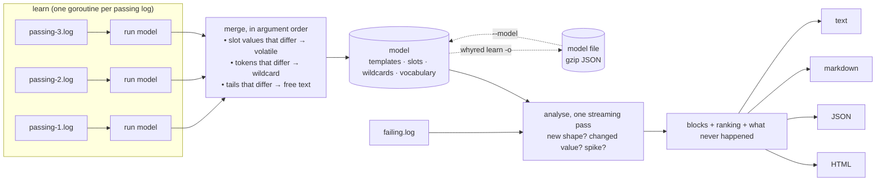
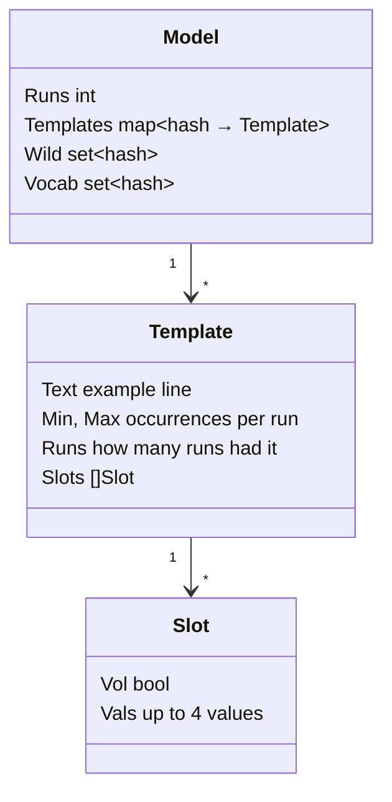
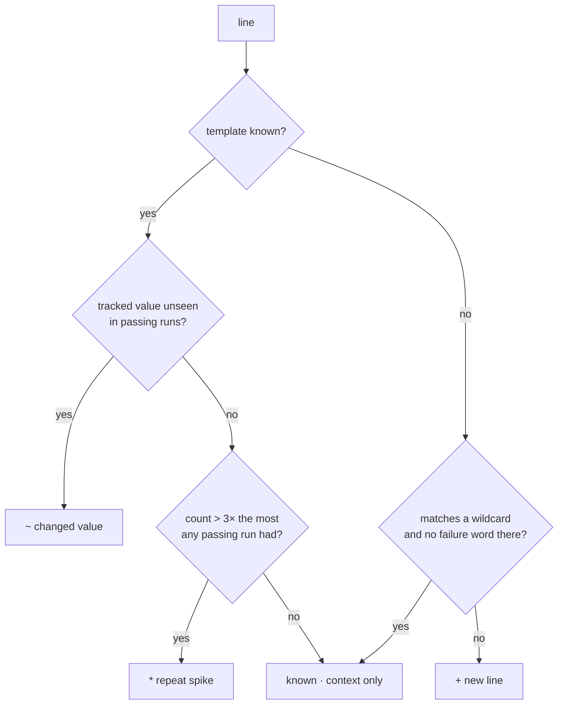

# Architecture

whyred is ~1,200 lines of Go with no dependencies outside the standard library.

| File | Responsibility |
|---|---|
| `tokenize.go` | line cleaning (ANSI, `\r`), tokeniser, token shapes, template hash, line reader |
| `model.go` | per-run learning, merging, wildcard learning, model save/load |
| `diff.go` | streaming analysis of the failing log, blocks, scoring |
| `report.go`, `report.html` | text, Markdown, JSON and self-contained HTML output |
| `main.go` | CLI, parallel loading, gzip / UTF-16 input |
| `bench/` | synthetic corpus generator and evaluation harness |

## 1. From a line to a template

A line is cleaned (ANSI escapes removed, only the text after the last `\r`
kept) and split on whitespace and `,;()[]{}"'<>|=` and backtick. Each token is one of:

- **Literal** — no digits. Its bytes are part of the template. `FAIL`, `src/a.ts`.
- **Slot** — contains a digit. Only its *shape* is part of the template; the
  concrete value is tracked separately (section 2).

Shapes are computed per alphanumeric segment:

| Token | Shape | Kind |
|---|---|---|
| `42` | `#` | tracked value |
| `lodash@4.17.21` | `lodash@#.#.#` | tracked value |
| `TS2345` | `TS#` | tracked value |
| `1.234s`, `120ms`, `84.2%`, `12.3MB` | `#.#s`, `#ms`, … | volatile (unit) |
| `12 ms` (number followed by a unit word) | `#` | volatile |
| `2026-11-10T12:00:01.123Z` | `<*>-<*>-<*>:<*>:<*>.<*>` | volatile, generated |
| `9f86d081884c…`, UUIDs, `index-BkH3d9Qa.js` | `<*>`, `index-<*>.js` | volatile, generated |

A segment is "generated" when it is hex of 7+ characters containing a digit, or
letters and digits interleaved more than once over 5+ characters. Short mixed
words (`k8s`, `i18n`, `e2e`) stay literal.

The template hash is `Σ mix(tokenHash[i], i) + n·K`. Because it is a sum keyed by
position, two derived hashes cost O(1) each:

- **leave-one-out**: the hash of "this line with token *i* replaced by anything";
- **prefix**: the hash of "any line starting with these *k* tokens".

Those are what make wildcard learning and matching cheap.

## 2. What the model stores

A slot is **volatile** (its value carries no signal) when any of these hold:

1. its type says so (duration, size, percentage, hash, timestamp …);
2. one run shows more than 4 distinct values for it (`step 1/300 … 300/300`);
3. **two passing runs show different value sets for it.**

Rule 3 is the point of the design. `Runner name: 'GitHub Actions 7'` looks like
a constant if you have one passing log. With two, they disagree, and the number
is noise from then on. Conversely `Tests: 0 failed`, `exit code 0` and
`+ lodash@4.17.20` are identical in every passing run, so a different value in
the failing run is reported as a **changed value**.

## 3. Wildcards: generalising literal tokens

Digits are not the only noise. Three rules, all conservative:

| Rule | Learned when | Example |
|---|---|---|
| Generated-id position | a template has a generated token at position *i* | `tmp dir /tmp/up-a8Xk2Q` in a passing run makes `/tmp/up-QwErTy` (no digits, would be a literal) match |
| Token wildcard | two templates differ in exactly one token **and never occur in the same run** | `suite finished PASS today` / `… SKIP today` |
| Prefix wildcard | templates share their first ≥4 tokens, never co-occur, **and together cover every run** | `HEAD is now at <sha> <a different commit message each run>` |

Guards: lines shorter than 3 tokens are never generalised (`Killed` must not
match `Done`), and a wildcard never absorbs text that matches the failure
lexicon — `suite finished FAILED today` is still reported.

## 4. Analysing the failing log

One streaming pass. For every line: clean, tokenise, hash, one map lookup.

Anomalous lines are grouped into **blocks** with `-C` lines of context, kept in
a ring buffer so memory does not depend on log size. Identical consecutive
anomalies collapse (`repeated 500x`); the same anomaly is shown at most three
times and counted after that; a report keeps at most 20,000 anomalous lines.

After the pass, templates present in **every** passing run and absent here are
listed as **what never happened**, in the order passing runs print them — the
first few show where the run stopped.

Order within the log is deliberately ignored: templates are compared as a
multiset. Parallel test runners print files in a different order every run, and
any line-aligned diff reports that as hundreds of changes.

## 5. Ranking

Ranking is a heuristic and is documented as one.

- new line: `1 + 2 × (share of tokens never seen in any passing run)`
- changed value: `1.2 + 0.8 × confidence`, where confidence is `1 − 1/runs`
- repeat spike: `0.8`
- reads like a failure (lexicon: error, fail, fatal, panic, denied, timeout, …):
  `+3`, plus up to `+2` for being early — the first failure is usually the
  cause and later ones its fallout.

A block scores as its best line plus a small bonus for size. Rank 1 is the
best-scoring block. Directly after it come blocks holding a value that all
passing runs agreed on and that **changed before the first failure** (needs
two or more passing runs): the silent cause nobody greps for. Then everything
else by score.

## 6. Decisions and their trade-offs

| Decision | Why | Cost |
|---|---|---|
| Exact template hashing, not Drain's similarity tree | deterministic, O(1) per line, no threshold to tune, no order dependence | a varying *word* without digits is a new template unless a wildcard rule covers it |
| Learn noise from passing-run disagreement | no pattern list to maintain; adapts to any tool's output | works best with 2–3 passing runs; one run falls back to type heuristics |
| Bag of templates, no alignment | immune to reordering | cannot say "this happened earlier than usual" |
| Failure lexicon only for ranking and wildcard guards, never to select lines | a failure that never says "error" is still found | English-centric ranking |
| Single pass, bounded report | 190 MB logs in ~20 MB of memory | the first three occurrences of an anomaly are shown, the rest counted |
| Go, standard library only | one static binary for every OS; nothing to audit but this repo | — |
| Model as gzip JSON | inspectable, language-neutral | larger than a binary format |

## 7. Concurrency and failure handling

- Passing logs are learned concurrently, one goroutine each, bounded by
  `GOMAXPROCS`. Each goroutine owns its model; merging happens afterwards on
  one goroutine in argument order, so results are deterministic and there is
  no shared mutable state. The failing log is analysed after the merge.
- Any unreadable input, bad flag, bad regex or malformed model is a message on
  stderr and exit status 2; no partial report is written. A model file that
  fails to save is removed.
- Lines longer than 64 KiB are truncated, never buffered whole. At most 256
  tokens of a line are considered.

## 8. Security

Logs are untrusted input: a pull request can print anything into them.

- **Terminal**: ANSI sequences are stripped before analysis, and every string
  that reaches a report has remaining control characters (C0, DEL, C1) replaced,
  so log content cannot move the cursor, set the title or hide text.
- **HTML**: report data is embedded as JSON with `<`, `>` and `&` escaped, and
  the page inserts log text only through `textContent`. No external resources
  are loaded.
- **Regex**: `--mask` uses Go's RE2 engine, which runs in linear time.
- **Models**: decompression is capped, the version is checked, and slot counts
  are bounds-checked on use.
- No network access, no subprocesses, no writes other than `-o`.

## 9. Known limits

- A model stores an example line per template and up to four values per
  tracked slot. Treat a model file as sensitive as the logs it came from.
- More than 64 passing logs are rejected (run membership is a 64-bit mask).
- Lines that repeat more often than in passing runs are reported once, as a
  spike, when the count passes `max(3×max+1, max+5)`; the individual repeats
  are not flagged.
- With a single passing run, values that happen to be constant in it (a runner
  number, a PID) are reported as changed. A second passing run fixes that.
- The benchmark corpus is synthetic. See [BENCHMARKS.md](BENCHMARKS.md).
